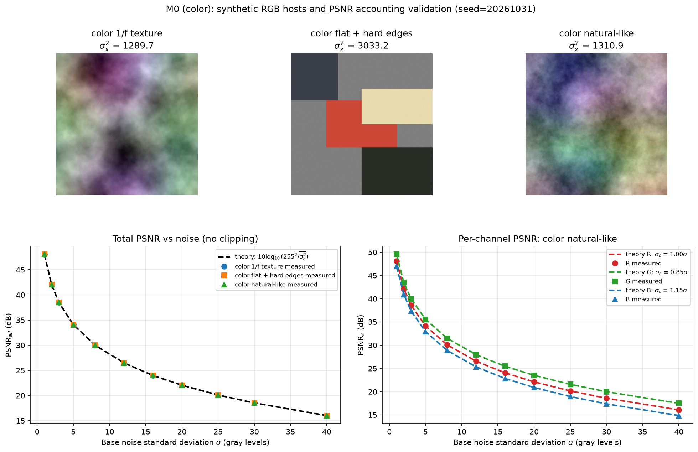
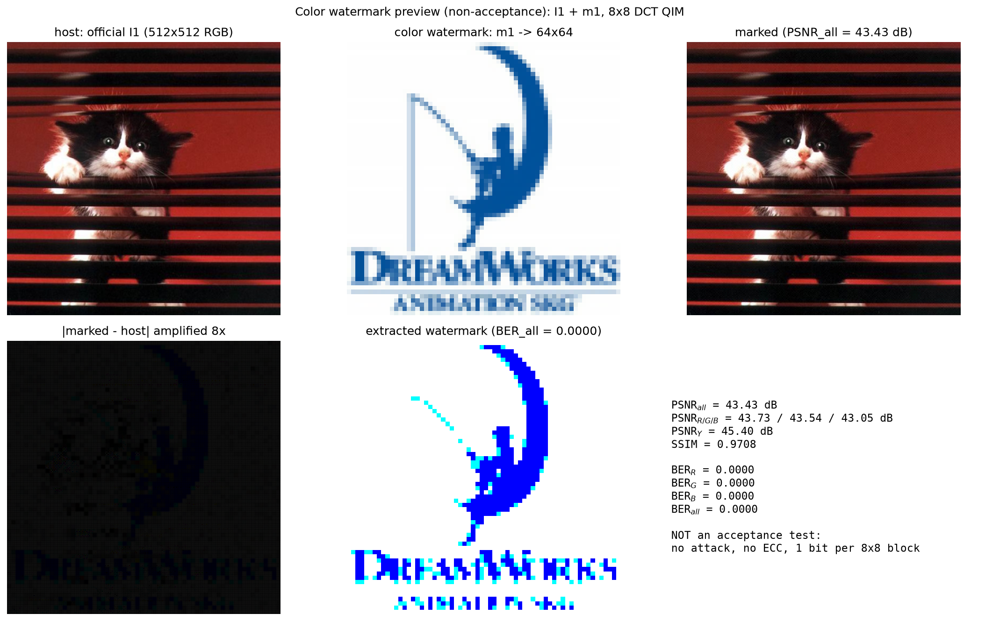

# M0 基线与度量（彩色版）

## 目标

建立后续所有模块共用的三件事：

1. 可控的**彩色**合成载体（RGB，512×512，不依赖赛题 4 张图）；
2. 统一的彩色度量：逐通道 PSNR、总 PSNR、亮度 PSNR、SSIM、BER；
3. 用“加噪后的 PSNR”把实现与解析式对齐，确认颜色通道、归一化和值域没有埋雷。

## 彩色约定

- 色彩空间统一为 RGB（float64，[0, 255]）；嵌入逐通道独立，灰度版的公式可逐通道复用。
- 同时报告三类失真：
  - `PSNR_c = 10·log10(255²/MSE_c)`，c ∈ {R, G, B}；
  - `PSNR_all = 10·log10(255²/mean_c MSE_c)`（总预算口径）；
  - `PSNR_Y = 10·log10(255²/MSE_Y)`，`Y = 0.299R + 0.587G + 0.114B`（BT.601）。
- 彩色水印 = logo 拆成 R/G/B 三个比特平面，分别嵌入对应通道；检测后分通道报告 BER。

## 理论要点

- 若三通道噪声标准差为 `σ_c`，则 `MSE_c = σ_c²`，于是
  `PSNR_c = 10·log10(255²/σ_c²)`，
  `PSNR_all = 10·log10(255²/mean_c σ_c²)`。
- 失真预算：`D = 255²/10^(PSNR_all/10)`；40 dB 对应 `D ≈ 6.50`。
- 归一化相关逐通道定义：`ρ_c(y, w) = <y_c, w_c>/(‖y_c‖‖w_c‖)`，是 M1 检测统计量的原型。
- BER 与判决裕度：裕度越小，噪声稍大就翻；彩色版要同时看 `BER_R/G/B` 和平均值，平均值会掩盖最差通道。

## 实验设置

- 脚本：`exp/m0_baseline.py`，随机种子 `20261031`。
- 载体：512×512、RGB、float64、范围 [0, 255]，三类（彩色 1/f 纹理、彩色平坦+硬边缘、彩色自然感）。
- 噪声：三通道零均值均匀分布 `U(-√3σ_c, √3σ_c)`，方差恰为 `σ_c²`；`σ_c = σ·[1.0, 0.85, 1.15]`，刻意让通道不同，用来检验逐通道记账。
- `σ ∈ {1, 2, 3, 5, 8, 12, 16, 20, 25, 30, 40}`；刻意不做 [0, 255] 截断，避免截断改变 MSE。

## 主图



上排为三类彩色载体；下排左为总 PSNR（`PSNR_all`），下排右为“彩色自然感”的逐通道 PSNR。所有实测点都落在对应解析虚线上。

## 表 1：三类彩色载体的分通道方差

| 载体 | σ²_R | σ²_G | σ²_B | 总 σ² | 均值 | 值域 |
|---|---:|---:|---:|---:|---:|---:|
| 彩色 1/f 纹理 | 1050.94 | 1714.66 | 1102.32 | 1289.70 | 127.14 | [3.0, 239.0] |
| 彩色平坦+硬边缘 | 3930.73 | 2808.30 | 2046.77 | 3033.15 | 114.30 | [31.9, 239.0] |
| 彩色自然感 | 1782.57 | 1280.73 | 855.90 | 1310.88 | 126.48 | [22.2, 231.8] |

## 验收结果

| 验收项 | 实测 | 阈值 | 结果 |
|---|---|---:|---|
| 逐通道 PSNR 最大偏差 | **0.0184 dB** | 0.1 dB | PASS |
| 总 PSNR 最大偏差 | **0.0134 dB** | 0.1 dB | PASS |
| `SSIM(x, x)` | 1.000000（三类均） | ≈1 | PASS |

复现命令：

```bash
python3 exp/m0_baseline.py
```

脚本末尾会打印 `RESULT: PASS/FAIL`，上面三项都通过时才为 PASS。

## 3 条结论

1. **彩色必须逐通道记账，不能只看总 PSNR。** 同一张图三通道方差可差约 1.6 倍（1/f：R 1050.94、G 1714.66），同一嵌入强度在 G 通道造成的失真明显更大；只报 `PSNR_all` 会把最差通道藏起来。
2. **总 PSNR 的口径是 `mean_c MSE_c`，实现与解析式一致。** 实测最大偏差 0.0134 dB（见上表），说明 RGB 值域、逐通道平均和 `10 log10` 口径没有单位或归一化错误；后续可直接用 `D = 255²/10^(PSNR_all/10)` 做总预算。
3. **亮度 PSNR 会高估彩色质量。** 预览中 `PSNR_all = 43.43 dB`，但 `PSNR_Y = 45.40 dB`，最差的 B 通道只有 43.05 dB。色度上的改动对亮度加权 MSE 贡献小，因此 `PSNR_Y` 不能单独作为彩色质量的验收指标。

## 自测题回答

**为什么三通道平均 PSNR 会掩盖某一通道的严重失真？**

`PSNR_all` 由三通道 MSE 的算术平均决定，高 PSNR（低 MSE）通道会把平均值拉高。例如 R/G 都是 50 dB、B 只有 30 dB 时，平均 MSE 仍主要由 B 决定，但平均值看起来比 30 dB 好得多。正确做法是同时报告 `PSNR_R/G/B`、`PSNR_all` 和最差通道，并与 `PSNR_Y` 对照；M5 会进一步说明色度不敏感带来的“可分配更大失真”与“被平均掩盖”是两件不同的事。

## 未解问题

1. **真实图像的 RGB 截断与色域。** 本模块为对齐理论没有截断；真实图像必须落在 [0, 255]，截断会让实际 MSE 小于标称 `σ_c²`。后续涉及 uint8 往返（JPEG、定点舍入）时必须用实测 MSE/PSNR 记账。
2. **通道相关性。** 合成载体的 R/G/B 通过 YCrCb 生成，天然相关；三通道噪声独立时误差不相关，但真实图像的通道误差可能相关，M1 的三通道联合检测方差需要重新验证。
3. **`PSNR_Y` 的适用边界。** 它只回答“亮度看起来如何”，不回答彩色水印的色度是否可辨；M5/M6 要引入色度 CSF 与 JPEG 4:2:0 后再定论。

## 附：彩色水印预览（非验收）



`exp/m0_color_preview.py` 读取官方 `I1` 与 `m1`，把 m1 重采样成 64×64，按每通道每 8×8 块 1 bit 的 QIM 嵌入（Δ=32，系数 (3,3)），再盲提取。结果：

- `PSNR_all = 43.43 dB`，`PSNR_R/G/B = 43.73/43.54/43.05 dB`，`SSIM = 0.9708`；
- `BER_R/G/B = 0/0/0`，提取出的彩色 logo 可辨认。

这张图**不进入 M0 验收统计**：它没有攻击、没有纠错，只用来确认“彩色图片 + 彩色水印”的观感与管线是通的。官方 I1–I4/m1–m4 只用于预览，理论结论仍用合成彩色宿主。
